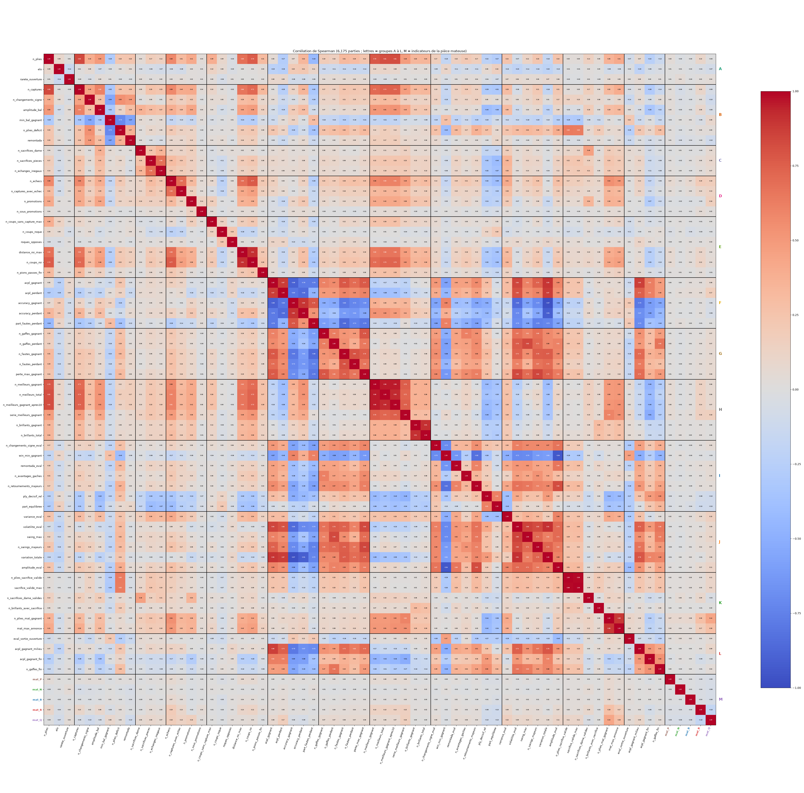
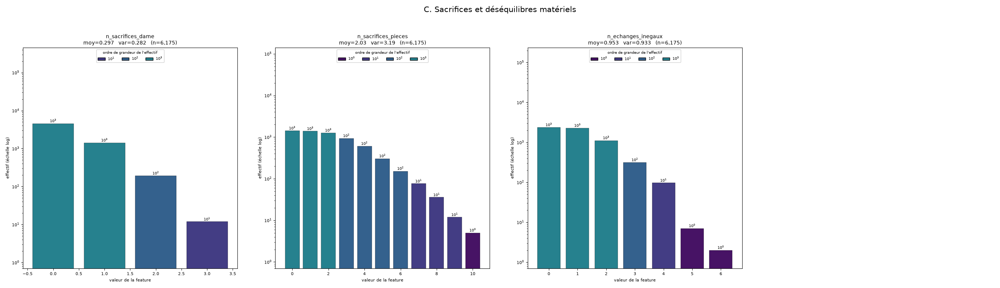
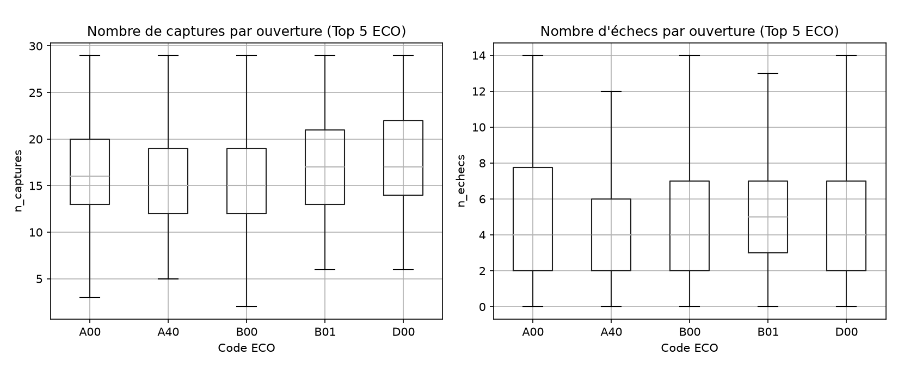
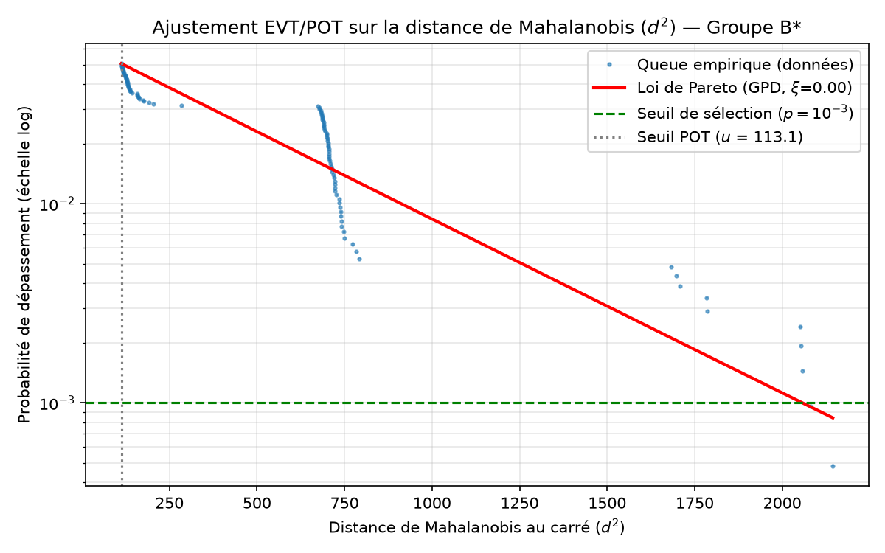

ensae-prog27

# Projet Python pour la data science : Titre du projet 

Auteurs : Camille BOURGET, Gautier COSTE, Valentin 
---

# Sommaire

## I : Introduction

### A : Contexte
### B : Objectif du projet
### B : Méthode
### C : Résultats

##  II : Méthode et vue d'ensemble qualitative du projet

### A : Problème des aiguilles dans une botte de foin
### B : Présentation du dataset
### C : 'L'esthétisme' : comment quantifier un concept humain ?
### D : Reproductibulité des résultats
### E : Usage de l’IA générative

## III : Présentation détaillée des trois couches

### A : Nettoyage et premières hypothèses
### B : Vectorisation et élagage statistique : théorie des valeurs extrêmes
### C :

## IV : Conclusion

---

## Introduction

### A : Contexte

Chaque mois près de 100 millions de parties d'échecs sont jouées sur lichess.org, le deuxième site le plus populaire en la matière. Chaque mois les joueurs proposent et élisent au cours d'un vote la 'game of the month', à savoir la plus belle partie selon des critères humains subjectifs d'esthétisme : [game of the month d'août dernier](blog/lichess-game-of-the-month-august-26/ekVdAfDN).

### B : Objectif du projet

L'objectif du projet est de concevoir un algorithme prenant en entrée les 100 milions de parties mensuelles et renvoyant 20 parties esthétiques pour l'oeil humain qui pourraient être désignées 'game of the month'.

Au cours de ce travail nous concevrons cet algorithme et évaluerons ses performances.

### B : Méthode

Nous avons à faire à un problème de recherche d'aiguille dans une botte de foin. Ainsi, notre algorithme fonctionne comme un entonnoir : trois filtres successifs permettent de passer du dataset complet à l'échantillon final de 20 parties.

Plus le filtre traite un nombre important de parties plus il doit être léger en s'appuyant sur des opérations simples, et inversément plus il est proche de la sortie de l'entonnoir plus il peut utiliser des méthodes couteuses pour classifier les dernières parties.

La première couche  (partie III A) correspond au nettoyage des données et à la sélection des parties sur lesquelles nous souhaitons nous attarder permettant de passer de 100 à 3 millions de parties, la seconde (partie III B) utilise des proproétés statistiques de manière à passer de 3 millions à 3 000 parties, et la dernière utilise un modèle de Machine Learning pour obtenir 20 parties.

### C : Résultats

## II : Méthode et vue d'ensemble qualitative du projet

### A : Problème des aiguilles dans une botte de foin

aa

### B : Présentation du dataset

Les données utilisées pour ce projet proviennent de la base de donnée Lichess : https://database.lichess.org/
Les données sont des parties au format PGN, le format standart pour enregistrer des parties d'échec. Pour chaque partie, le PGN contient : le tournoi ou contexte de la partie, le lieu, la date, la ronde, les noms de joueurs, le resultat le classement des joueurs et la cadence, ainsi que l'ensemble de la partie avec les coups en notation algébrique standart (SAN). Ce format permet de stocker un maximum de données sur une partie tout en étant très léger, ce qui nous a permis de travailler sur un grand nombre de parties (environ 100 millions de parties par mois).

### C : 'L'esthétisme' : comment quantifier un concept humain ?

Notre objectif étant de trouver les plus belles parties parmis celles jouées dans le mois, la première question était de définir ce qui fait une "belle" partie d'échecs. En effet, on part d'une notion subjective et humaine, qui ne peut être saisie par une machine. Il faut donc l'adapter avec des critères quantifiables et mesurables pour s'en approcher un maximum, et permettre de filtrer les nombreuses parties pour n'en conserver que quelques unes. Ainsi, nous avons selectionnés les éléments qui nous parraissaient les plus pertinents pour juger de l'esthétisme d'une partie d'échecs : les retournements d'avantages, les sacrifices de pièces, le dynamisme de la partie ... Nous avons ainsi dû selectionner nos critères de tri des parties, ainsi que la façon de les mesurer, afin de filtrer les parties au fur et à mesure, en commençant par les critères les plus évidents et facilement quantifiables pour ensuite étudier plus précisemment les parties restantes (voir partie II). 

### D - Reproductibilité des résultats

**Reproductibilité des chemins d’accès**

Les fichiers “filtrer_parties.py” et “analyse_features.py” comprennent la variable RACINE qui permet à n’importe quelle machine de retrouver le projet dans son ensemble, indépendamment de son emplacement en local. De même, la variable DOSSIER renvoie aux données directement depuis le projet (préciser le truc LICHESS j’ai pas compris). Les variables FICHIER et SORTIE permettent quant à elles de clarifier le parcours exact des fichiers (données filtrées puis analysées). Les deux scripts permettent acceptent également des options en ligne de commande (--dossier, –dump, –fichier) qui adaptent les chemins d’entrée et sortie des fichiers directement lors de l’exécution. 

**Paramètres et filtres explicites**

Les règles appliquées, notamment afin de filtrer et évaluer les parties sont regroupées en haut des fichiers pour ne laisser aucune ambiguïté. Dans “filtrer_parties.py” : COUP_MIN, COUP_MAX par exemple, ou dans “features_core.py” : VALEUR (vecteur des valeurs des pièces). 

**Calcul en flux constant**

Pour que le projet puisse être exécuté sur n'importe quelle machine sans saturer la mémoire vive (RAM), l'ensemble du traitement est conçu en flux continu. Dans “filtrer_parties.py”, le fichier compressé Lichess est lu au fil de l'eau (stream_reader) et écrit sur disque par lots de 100 000 parties (vider_lot), sans jamais être entièrement décompressé en mémoire. De la même manière, analyse_features.py traite les données par blocs (iter_batches) et met à jour les statistiques au fur et à mesure via la classe Accumulateur. 

### E - Usage de l’IA générative
Il convient enfin de détailler l’usage qui a été fait de l’IA générative pour réaliser ce projet. Avant tout, l’IA nous a permis de trouver rapidement des datasets adaptés à notre projet sur internet. Concernant le projet en lui-même, nous avons codé une première version permettant d’avoir un squelette déjà opérationnel sur un nombre de parties restreint. Cette première version manuelle était d’ailleurs nécessaire pour garder la main sur l’ensemble des critères choisis, qui visent in fine à détecter des “belles parties”, ce que l’IA ne saurait inventer d'elle-même. Ce n’est que par la suite que nous avons employé Claude notamment, pour débugger certains blocs, et scaler notre projet afin de le rendre applicable à des millions de parties (ex : multiprocessing dans analyse_features.py). La rédaction du README a enfin été essentiellement manuelle pour s’assurer de la clarté et de la pertinence des explications au regard de nos propres impressions. 

---

La première étape de notre projet consiste à réduire grandement l'échantillon de données pour ne conserver qu'un nombre restreint de parties intéressantes, que nous analyserons ensuite de manière plus poussée. 
Pour cela, nous regroupons les parties par paquets de 500 000, et nous effectuons le filtrage suivant : conserver seulement les parties avec un vainqueur, dont les deux joueurs ont plus de 1500 elo (ce qui correspond au top 50% des joueurs) et avec un faible écart de niveau entre les joueurs. Nous avons supprimons ensuite les parties jouées par correspondance, et celles dont l'évaluation n'est pas disponible : l'évaluation nous permet d'avoir plus d'informations sur la partie, et le fait qu'un des joueurs ait cherché à l'évaluer renvoie déjà un signal sur sa qualité. 
A la fin de cette étape, il nous reste un total de *3 124 123* parties, soit *3,3 %* du nombre du départ. Cette première étape nous permet donc de réduire grandement la quantité de données à traiter de manière rapide et efficace (on a peu de chance d'éliminer une des plus "belles" parties de cette façon).
Enfin, en plus de fluidifier l'exécution du code, le fait de regrouper les parties par groupe de 500 000 nous a permis d'évaluer combien de parties ce filtrage conserve en moyenne afin dimensionner au mieux l'étape suivante. En effet, nous avons constaté lors des tests que cette étape conserve en moyenne *158 000* parties par groupe, avec une faible variance empirique (*3%* de la moyenne). Sur cette base, nous avons donc calibré l'algorithme de l'étape suivante pour traiter 3 millions de parties, le risque de dépasser significativement ce nombre étant très faible. 

## III : Présentation détaillée des trois couches

# A : Nettoyage et premières hypothèses

La première étape de notre projet consiste à réduire grandement l'échantillon de données pour ne conserver qu'un nombre restreint de parties intéressantes, que nous analyserons ensuite de manière plus poussée. 
Pour cela, nous regroupons les parties par paquets de 500 000, et nous effectuons le filtrage suivant : conserver seulement les parties avec un vainqueur, dont les deux joueurs ont plus de 1500 elo (ce qui correspond au top 50% des joueurs) et avec un faible écart de niveau entre les joueurs. Nous avons supprimons ensuite les parties jouées par correspondance, et celles dont l'évaluation n'est pas disponible : l'évaluation nous permet d'avoir plus d'informations sur la partie, et le fait qu'un des joueurs ait cherché à l'évaluer renvoie déjà un signal sur sa qualité. 
A la fin de cette étape, il nous reste un total de *3 124 123* parties, soit *3,3 %* du nombre du départ. Cette première étape nous permet donc de réduire grandement la quantité de données à traiter de manière rapide et efficace (on a peu de chance d'éliminer une des plus "belles" parties de cette façon).
Enfin, en plus de fluidifier l'exécution du code, le fait de regrouper les parties par groupe de 500 000 nous a permis d'évaluer combien de parties ce filtrage conserve en moyenne afin dimensionner au mieux l'étape suivante. En effet, nous avons constaté lors des tests que cette étape conserve en moyenne *158 000* parties par groupe, avec une faible variance empirique (*3%* de la moyenne). Sur cette base, nous avons donc calibré l'algorithme de l'étape suivante pour traiter 3 millions de parties, le risque de dépasser significativement ce nombre étant très faible. 

### B - Second filtrage et évaluation des parties (features_core et analyse_feature)

La seconde étape correspond à l’analyse et l’évaluation des 3 millions de parties conservées. Le but étant de distinguer une poignée de parties exceptionnelles.

D’abord, il s’agit de définir des features (critères d’évaluation) que l’on peut regrouper au sein des catégories suivantes : complexité de la partie (elo moyen des deux joueurs, longueur de la partie), combats et fluctuations matérielles (nombre de captures, remontada…), sacrifices et déséquilibre d’échanges, complexité tactique (nombre d’échecs, de coup avec capture, de promotion…), dynamisme de la partie (nombre de coup du roi, longueur max d’une séquence sans capture). Une quarantaine de features sont calculées partie par partie dans features_core.py (fonctions features_partie et features_eval).Chaque partie est alors identifiée comme un vecteur de dimension du nombre de features.

Ensuite, il s’agit d’identifier les vecteurs, et de fait les parties, les plus rares. C’est une des grandes difficultés auxquelles nous avons été confrontés puisqu’il fallait déterminer une métrique pour classer les vecteurs, en s’assurant que celle-ci permettrait de distinguer des  “belles parties” conformément à notre opinion sur l’esthétisme.

Pour ce faire, nous avons cherché à obtenir un score d’atypicité d’une partie à partir de sa distance au centre de gravité de nos 3 millions de vecteurs. Les métriques classiques (norme infinie, distance euclidienne) ne convenaient pas puisqu’elles ne prennent pas en compte l’échelle différente des variables (binaires, sur N, sur Z-...) et la corrélation entre ces variables (une partie longue a mécaniquement plus de captures par exemple). C’est pourquoi nous avons utilisé la distance de Mahalanobis qui corrige ces deux défauts. De plus, nous avons scindé les calculs par type d’ouverture (certaines ouvertures aboutissent à des parties plus longues par exemple). En outre, c’est une version robuste de la distance qui a été employée afin de limiter l’effet des valeurs extrêmes sur le centre de gravité. Précisément, dans elagage_evt.py, les parties sont d'abord regroupées par code ECO (groupes_reference), puis les variables sont transformées (transformer) et la distance de Mahalanobis robuste est calculée en écartant itérativement les 10 % de parties les plus extrêmes (ajuster avec TRIM = 0.9, puis distances).

Enfin, une fois que l’on a ces scores d’atypicité, il faut pouvoir en déduire quelles parties sont vraiment “exceptionnelles”. Un top 100 (ou autre) n’a pas de justification statistique par exemple. C’est pourquoi nous avons utilisé l’EVT (extreme value theory) via la méthode POT (Peaks Over Threshold). Cela consiste à calculer pour chaque partie, la probabilité qu’une partie de cette même ouverture soit au moins aussi atypique que celle-ci (p-valeur de rareté). On peut alors dire des parties dont cette probabilité est inférieure à un seuil préalablement déterminé (0.1% par exemple) qu’elles sont véritablement exceptionnelles. 

## Justification statistique de la méthodologie

En amont du traitement des parties, nous avons observé les données par le biais de statistiques descriptives. Cela nous a permis d'employer les méthodes adaptées au dataset, mentionnées ci-dessus (Mahalanodis, découpage par ouverture, modélisation EVT/POT...). 
NB : ces statistiques ont été réalisées sur 200 000 parties du fait de difficultés à télécharger l'ensemble du dataset. 

1. **Corrélations entre features**

*Les fortes corrélations observées entre variables (notamment entre la longueur de la partie et les compteurs de captures ou d'échecs) prouvent qu'une distance euclidienne biaiserait le score et justifient l'usage de la distance de Mahalanobis.*

2. **Distributions asymétriques à queues longues**

*Les distributions fortement asymétriques (où l'immense majorité des parties reste proche de zéro tandis que quelques cas atteignent des valeurs extrêmes) justifient à la fois la transformation `log1p` et le recours à la théorie des valeurs extrêmes.*

3. **Différences selon l'ouverture (code ECO)**

*Les écarts de distribution observés entre les principales ouvertures confirment que la « norme » dépend du type de partie joué, ce qui impose de calculer la distance de Mahalanobis et les seuils de rareté ouverture par ouverture.*

4. **Modélisation de la queue par EVT / POT**

*Au-delà du seuil du 95e percentile ($u$), la loi de Pareto généralisée modélise la queue des distances de Mahalanobis et permet d'isoler rigoureusement les parties statistiquement exceptionnelles sous le seuil $p \le 10^{-3}$.*
